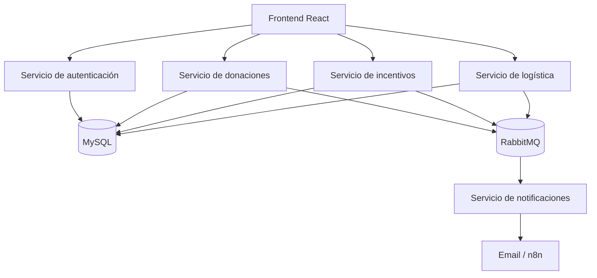
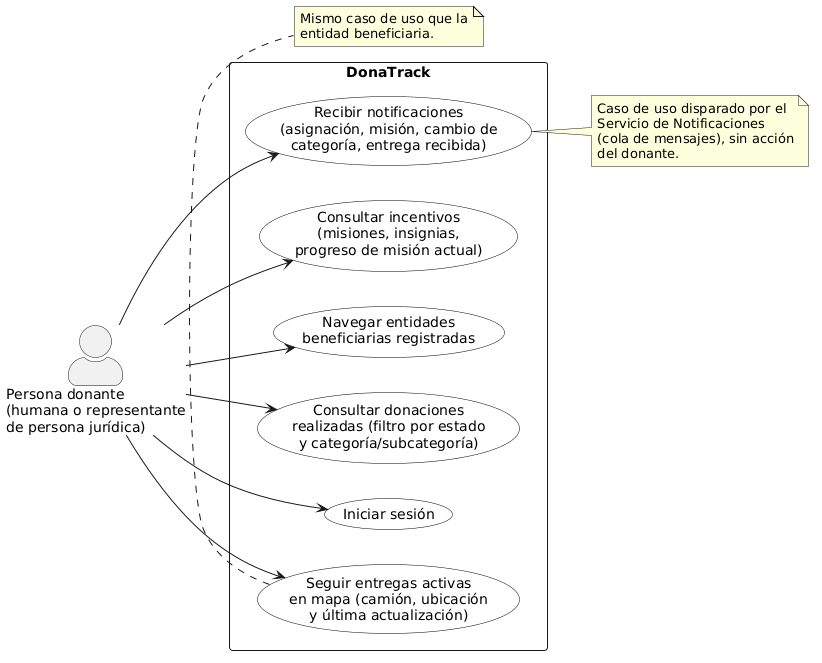
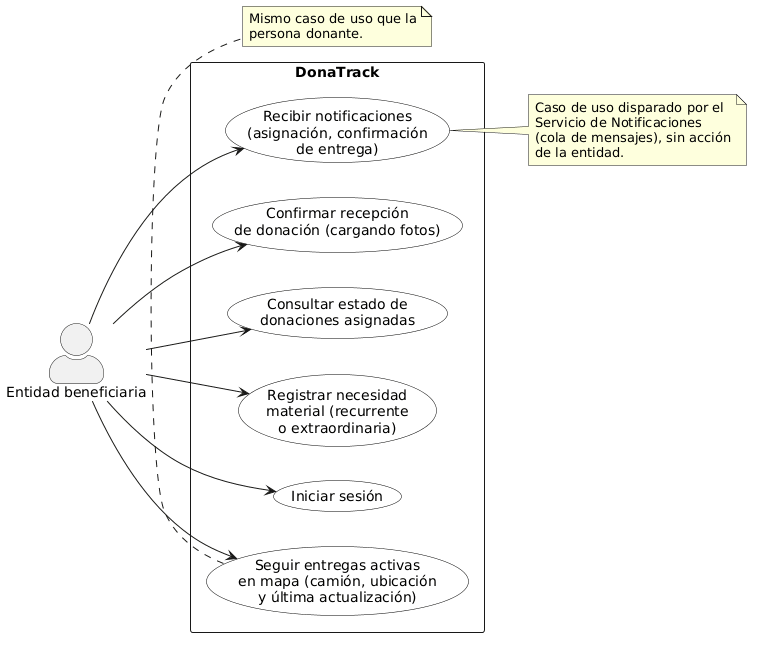
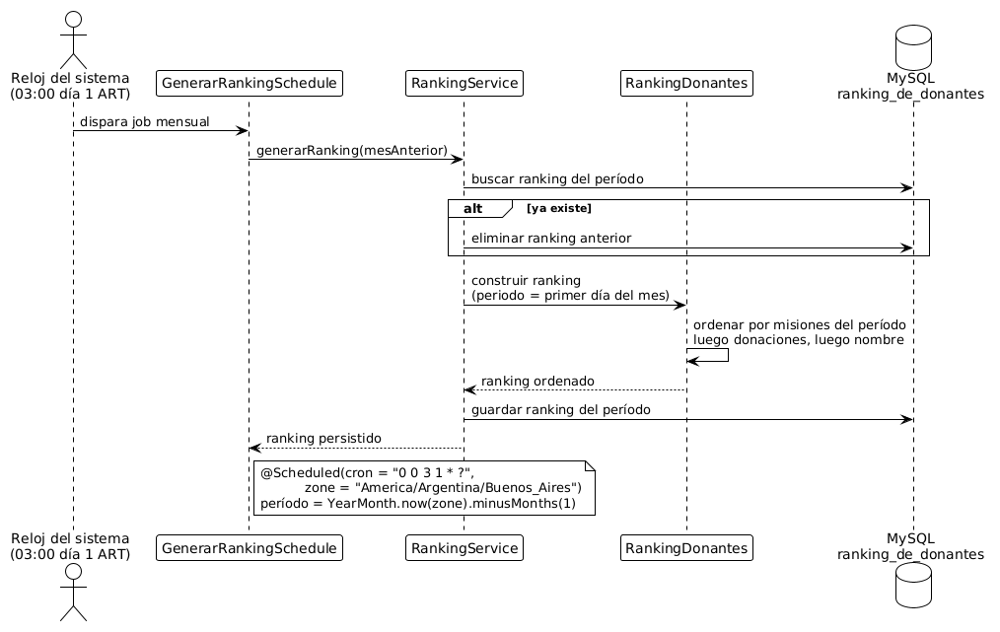
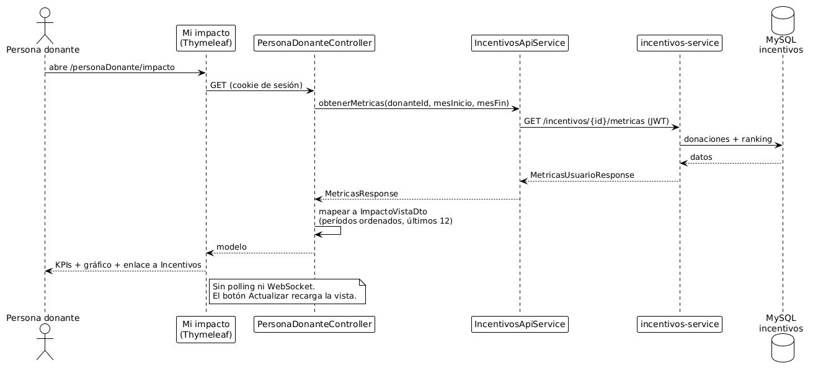

# DonaTrack — Plataforma de Donaciones


[English](README.md) | [Español](README.es.md)

> Trabajo Práctico Anual Integrador de **Diseño de Sistemas de Información**, UTN FRBA, 2026.
> Hecho con **5 compañeros**.

## ¿Qué es DonaTrack?

DonaTrack conecta **donantes**, **entidades beneficiarias** y **logística** en una sola plataforma. Las donaciones se registran, se segmentan por categoría y subcategoría, se vinculan con necesidades, se asignan a rutas de entrega y se siguen mediante notificaciones e incentivos.

## Arquitectura



### Servicios

| Módulo | Responsabilidad |
|---|---|
| `autenticacion-service` | Usuarios, roles y autenticación |
| `donaciones-service` | Donantes, donaciones, entidades y necesidades |
| `incentivos-service` | Misiones, insignias, rankings y métricas de impacto |
| `logistica-service` | Rutas, entregas y comprobantes |
| `notificacion-service` | Notificaciones por email y eventos |
| `common-lib` | Dominio compartido, DTOs e infraestructura |
| `front-end-app` | Aplicación web con Thymeleaf/React |

## Flujos principales

- **Ingreso de donaciones:** una carga se segmenta en donaciones independientes por subcategoría, vencimiento y estado.
- **Vinculación con necesidades:** las entidades publican necesidades recurrentes y extraordinarias.
- **Ranking mensual:** un job programado construye el ranking a las 03:00 del primer día de cada mes.
- **Panel de impacto:** el donante ve su historial, entidades ayudadas y posición en el ranking.






## Mi rol

Desarrollador full-stack en un equipo de 6 personas. Trabajé en los servicios de incentivos y donaciones y en el frontend:

- **Ranking mensual de incentivos** y endpoints de ranking a demanda.
- Vistas de entidades beneficiarias con filtros y conteo de impacto mensual.
- Mapeo de DTOs entre entidades de dominio y respuestas de API.
- Persistencia con JPA/Hibernate y migración de repositorios.
- Docker Compose y arranque local sin intervención.
- Flujos de frontend para donaciones, entidades e incentivos.

## Testing

- **43 tests** en los servicios.
- Cobertura de dominio, servicios e integración para donaciones, incentivos, logística y notificaciones.

## Spec-driven development

- **12 cambios OpenSpec** con propuesta, diseño y tareas.
- Las especificaciones y criterios de aceptación se escriben antes de implementar.

## Stack

`Java 21` · `Spring Boot` · `Spring Cloud` · `Spring Data JPA` · `Hibernate` · `MySQL` · `RabbitMQ` · `Docker Compose` · `Maven` · `JUnit`

## Cómo levantarlo

```bash
cp .env.example .env
docker compose up --build
```

Servicios principales:

| Servicio | Puerto |
|---|---:|
| API Donaciones | 8080 |
| API Incentivos | 8081 |
| API Logística | 8083 |
| RabbitMQ management | 15672 |
| MySQL | 3307 |

## Estructura

```text
├── autenticacion-service/
├── common-lib/
├── donaciones-service/
├── incentivos-service/
├── logistica-service/
├── notificacion-service/
├── front-end-app/
├── docker/
├── docs/
├── openspec/
└── docker-compose.yml
```

## Notas

- Código publicado con fines de portfolio.
- No hay credenciales en el repo; se configuran por `.env`.
- La documentación académica completa está en `docs/` y `openspec/`.
