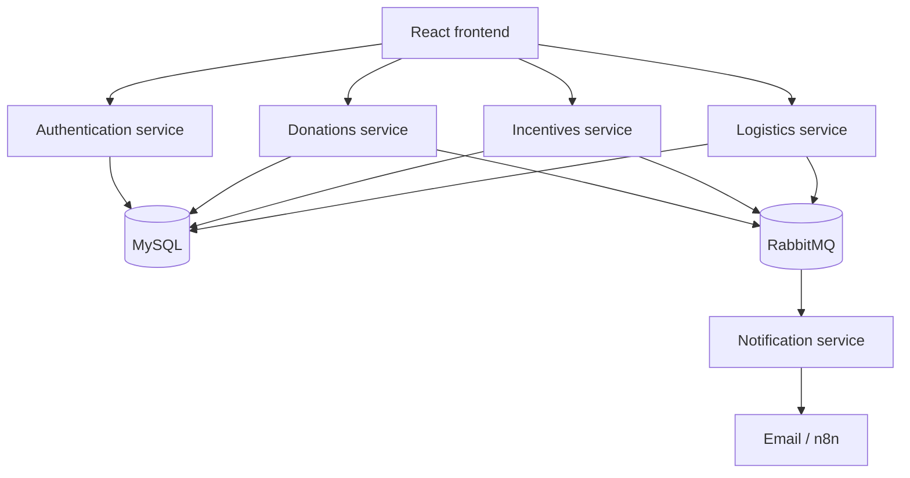
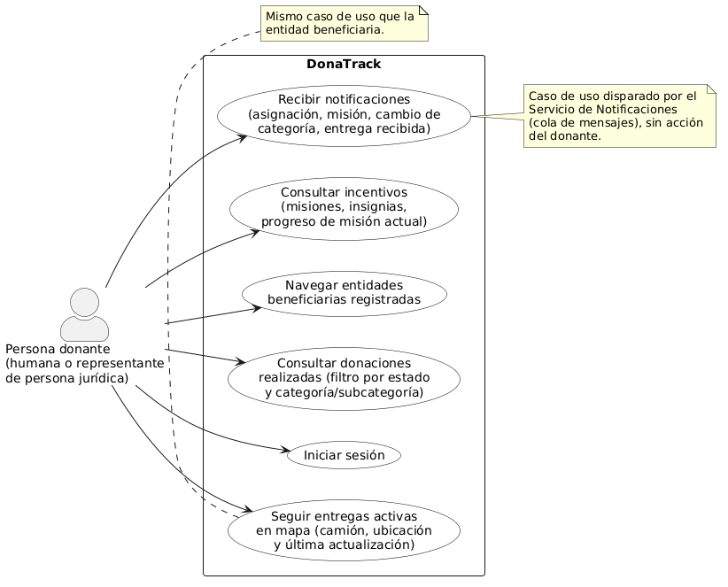
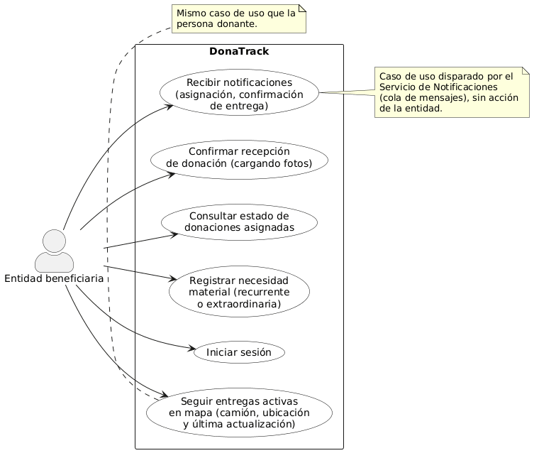
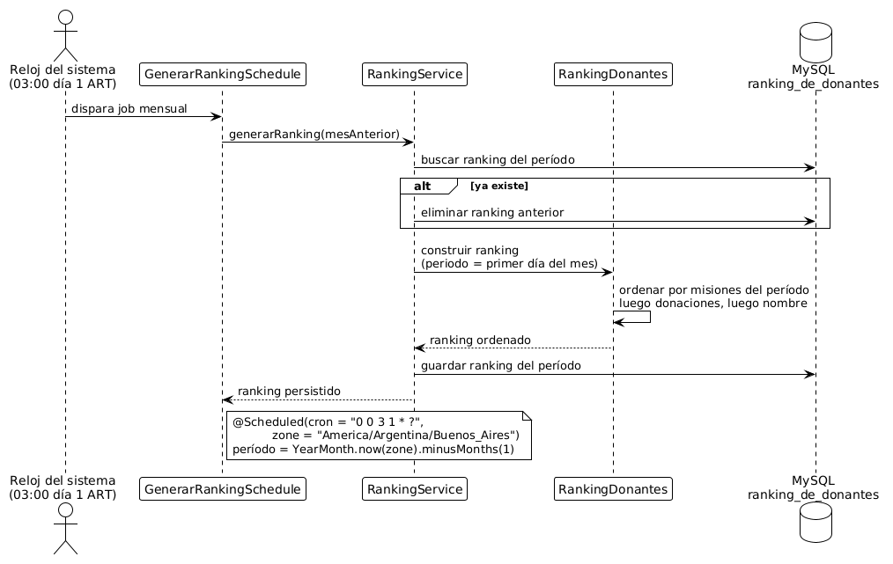
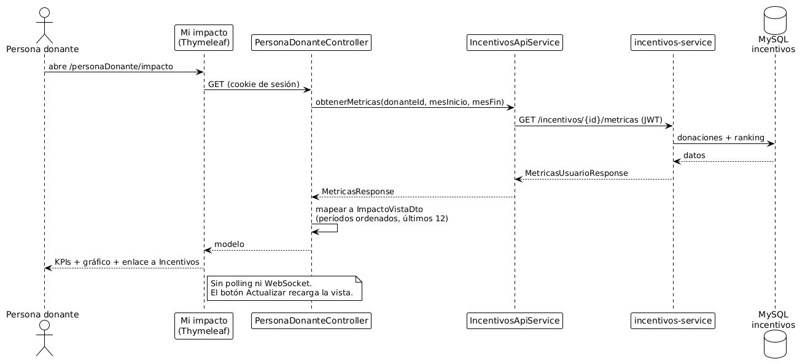

# DonaTrack — Donation Platform


[English](README.md) | [Español](README.es.md)

> Academic capstone project for **Diseño de Sistemas de Información**, UTN FRBA, 2026.
> Built with **5 colleagues**.

## What is DonaTrack?

DonaTrack connects **donors**, **beneficiary organizations** and **logistics** in one platform. Donations are registered, segmented by category and subcategory, matched with needs, assigned to delivery routes, and tracked through notifications and incentives.

## Architecture



### Services

| Module | Responsibility |
|---|---|
| `autenticacion-service` | Users, roles and authentication |
| `donaciones-service` | Donors, donations, beneficiary entities and needs |
| `incentivos-service` | Missions, badges, rankings and impact metrics |
| `logistica-service` | Routes, deliveries and proof of delivery |
| `notificacion-service` | Email and event-driven notifications |
| `common-lib` | Shared domain, DTOs and infrastructure |
| `front-end-app` | Thymeleaf/React-facing web app |

## Key flows

- **Donation intake:** one load is segmented into independent donations by subcategory, expiration and condition.
- **Needs matching:** beneficiary organizations publish recurring and extraordinary needs.
- **Monthly ranking:** a scheduled job builds the donor ranking at 03:00 on the first day of each month.
- **Impact panel:** donors see their history, helped organizations and ranking position.






## My role

Full-stack developer in a 6-person team. I worked across the incentives and donations services and the frontend:

- Monthly **incentive ranking** and on-demand ranking endpoints.
- Beneficiary entity views with filters and monthly impact counters.
- DTO mapping between domain entities and API responses.
- JPA/Hibernate persistence and repository migration.
- Docker Compose setup and zero-intervention local startup.
- Frontend flows for donations, entities and incentives.

## Testing

- **43 tests** across the services.
- Domain, service and integration coverage for donations, incentives, logistics and notifications.

## Spec-driven development

- **12 OpenSpec changes** documenting proposals, design and tasks.
- Specs and acceptance criteria are written before implementation.

## Stack

`Java 21` · `Spring Boot` · `Spring Cloud` · `Spring Data JPA` · `Hibernate` · `MySQL` · `RabbitMQ` · `Docker Compose` · `Maven` · `JUnit`

## Running locally

```bash
cp .env.example .env
docker compose up --build
```

The main services are exposed on:

| Service | Port |
|---|---:|
| Donations API | 8080 |
| Incentives API | 8081 |
| Logistics API | 8083 |
| RabbitMQ management | 15672 |
| MySQL | 3307 |

## Project structure

```text
├── autenticacion-service/
├── common-lib/
├── donaciones-service/
├── incentivos-service/
├── logistica-service/
├── notificacion-service/
├── front-end-app/
├── docker/
├── docs/
├── openspec/
└── docker-compose.yml
```

## Notes

- Code published for portfolio purposes.
- No credentials are committed; configure them through `.env`.
- Full academic documentation is available under `docs/` and `openspec/`.
