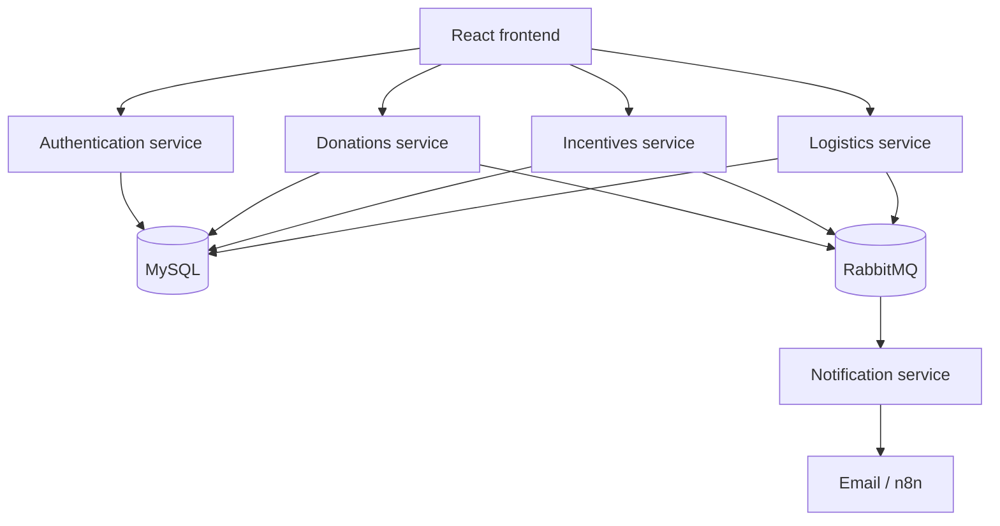

# DonaTrack — Donation Platform

> Academic capstone project — **Diseño de Sistemas de Información**, UTN FRBA, 2026.
> The production repository is private. This case study documents the architecture, my role and the main engineering decisions.

## Overview

DonaTrack connects **donors**, **beneficiary organizations** and **logistics** in one platform. Donations are registered, segmented by category and subcategory, matched with needs, assigned to delivery routes, and tracked through notifications and incentives.

## Architecture

The system is a Maven multi-module monorepo:

| Module | Responsibility |
|---|---|
| `autenticacion-service` | Users, roles and authentication |
| `donaciones-service` | Donors, donations, beneficiary entities and needs |
| `incentivos-service` | Missions, badges, rankings and impact metrics |
| `logistica-service` | Routes, deliveries and proof of delivery |
| `notificacion-service` | Email and event-driven notifications |
| `common-lib` | Shared domain, DTOs and infrastructure |
| `front-end-app` | React frontend |

## My role

Full-stack developer in a 6-person team. I worked across the incentives and donations services and the React frontend:

- Monthly **incentive ranking** and on-demand ranking endpoints.
- Beneficiary entity views with filters and monthly impact counters.
- DTO mapping between domain entities and API responses.
- JPA/Hibernate persistence and repository migration.
- Docker Compose setup and zero-intervention local startup.
- Frontend flows for donations, entities and incentives.

## Engineering decisions

- **Microservices by business capability**, with a shared library for cross-cutting concerns.
- **RabbitMQ** for asynchronous notification and event propagation.
- **DTOs at the API boundary** to avoid leaking persistence entities.
- **Docker Compose** for reproducible local environments.
- **OpenSpec / spec-driven changes** to describe behavior and acceptance criteria before implementation.

## Stack

`Java 21` · `Spring Boot` · `Spring Cloud` · `Spring Data JPA` · `Hibernate` · `MySQL` · `RabbitMQ` · `Thymeleaf` · `Docker Compose` · `Maven`

## Links

- [LinkedIn](https://www.linkedin.com/in/luca-domio-dev)
- [Portfolio](https://github.com/lDomio)
- Code and full documentation available on request.
