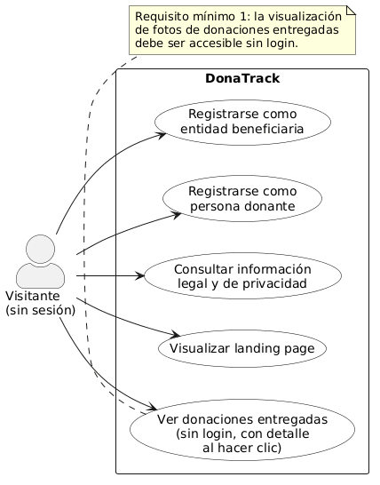
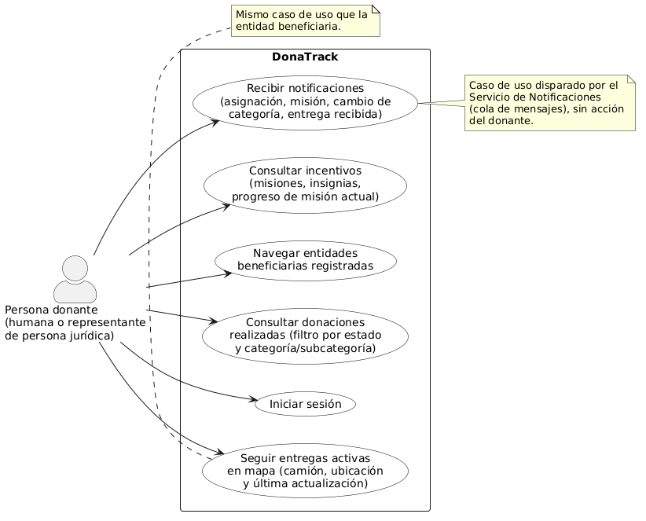
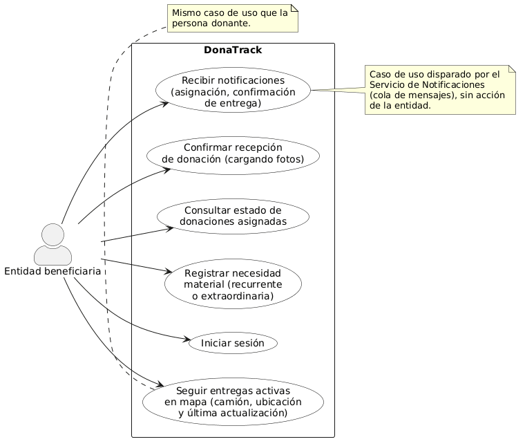
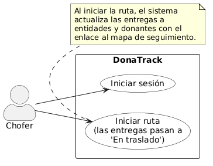
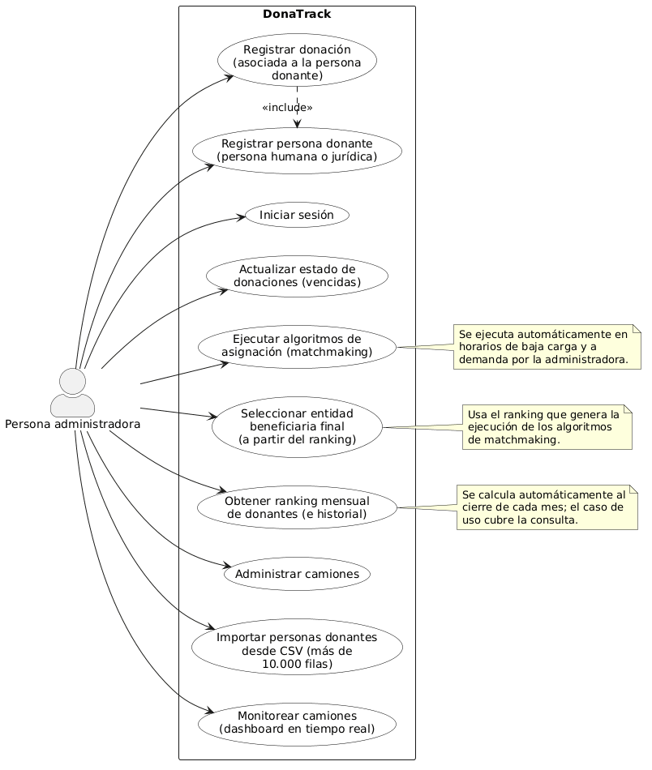

# Trazabilidad de casos de uso ↔ consigna del TP

Documento que contrasta cada caso de uso de los diagramas por actor (`docs/casosDeUso/*.puml`)
con la cita del enunciado del TP (`docs/enunciado.md`) de donde se extrajo. Las citas
conservan la redacción original; entre corchetes `[...]` va la línea del archivo.

Los diagramas se dividieron por actor para que cada uno se lea sin superposición. Los PNG
se regeneran desde la raíz del repo con `./scripts/plantuml-render.sh docs/casosDeUso`.

## Visión de cambios respecto del diagrama anterior

| Cambio | Motivo |
|---|---|
| Nuevo actor **Visitante** | La landing y las fotos de donaciones entregadas son sin login (req. 1). |
| Nuevo actor **Chofer** | La entrega 3 le asigna el inicio de ruta. |
| El caso **"Ver donaciones ya entregadas"** se separó de "Iniciar sesión" | Contradictorio con el req. 1: debe verse **sin login**. |
| **"Ver entregas en tiempo real"** ahora también conecta a Persona donante | Reqs. 9 y 14 lo exigen a ambos actores. |
| Nuevos casos: **Ejecutar algoritmos de asignación**, **Monitorear camiones (dashboard)**, **Recibir notificaciones**, **Iniciar ruta**, **Consultar información legal** | Requerimientos que existían en código pero no en el diagrama. |
| **"Registrar usuario"** (ambiguo) → **"Registrarse como persona donante"** / **"Registrarse como entidad beneficiaria"** + **"Registrar persona donante"** (admin) | Req. 15 distingue el registro que hace la administradora del self-service del req. 3. |
| Se quitó el `<<include>>` masivo hacia "Iniciar sesión" (20 flechas) | Legibilidad; cada caso de uso autenticado lo presupone. Está documentado como decisión. |
| El diagrama se dividió en **uno por actor** | El diagrama consolidado quedaba encimado; cada actor se lee de forma independiente. |

---

## Visitante

### Visualizar landing page
> "El sistema debe contar con una *landing page* accesible públicamente que permita: Presentar el propósito y objetivos de DonaTrack." `[74-75]`

Estado en el código: implementado (`front-end-app` `main.html`, `quienesSomos.html`, `programas.html`, `empresas.html` con `permitAll` en SecurityConfig).

### Ver donaciones entregadas (sin login, con detalle al hacer clic)
> "Visualización de fotos de donaciones entregadas sin login." `[78]`
> "El sistema debe mostrar las donaciones ya entregadas a entidades beneficiarias en un mapa interactivo y permitir ver sus detalles al hacer clic en cada marcador." `[81]` (req. 2)

Estado en el código: entidad `Foto` y `Bien.foto` en donaciones-service; el acceso público sin login queda como punto a verificar.

### Consultar información legal y de privacidad
> "Incluir enlaces de acceso a: ... 3. Información legal y de privacidad." `[77, 80]`

Estado en el código: pendiente de implementar.

### Registrarse como persona donante
> "El sistema debe permitir el registro de personas donantes y entidades beneficiarias." `[82]` (req. 3)
> "A las personas humanas se les solicita nombre, apellido, edad, número de documento, género y dirección y al menos un medio de contacto... las personas jurídicas deben indicar razón social, su tipo (Gubernamental, ONG, Empresa, Institución), rubro y al menos un medio de contacto. Cada organización tendrá personas representantes habilitadas a operar en su nombre." `[146, 148]`
> "se les enviará un correo electrónico de bienvenida para que accedan por primera vez." `[152]`

Estado en el código: implementado (`registro.html`, `AccesoController`).

### Registrarse como entidad beneficiaria
> "El sistema debe permitir el registro de personas donantes y entidades beneficiarias." `[82]` (req. 3)
> "De cada entidad se conoce su razón social, dirección completa, teléfono y correos de las personas representantes designadas." `[177]`

Estado en el código: implementado (`registrarEntidadBeneficiaria.html`).

---

## Persona donante

### Iniciar sesión
> "El sistema debe permitir el inicio de sesión de personas donantes, entidades beneficiarias y personas administradoras." `[83]` (req. 4)
> Se deberá incorporar un servicio de Autenticación, encargado de la gestión de tokens de autorización." `[613]` (entrega 5)

### Consultar donaciones realizadas (filtro por estado y categoría/subcategoría)
> "La persona donante debe poder filtrar sus donaciones realizadas por estado y categoría o subcategoría/s de bienes entregados." `[88]` (req. 5)

Estado en el código: implementado (`misDonaciones.html`, con el filtrado del cambio `entidades-conteo-filtro`).

### Navegar entidades beneficiarias registradas
> "La persona donante debe poder navegar por las entidades beneficiarias registradas." `[89]` (req. 6)

Estado en el código: implementado (`entidadesBeneficiarias.html`).

### Consultar incentivos (misiones, insignias, progreso de misión actual)
> "La persona humana donante debe poder acceder a una sección de Incentivos y consultar misiones a realizar e insignias obtenidas." `[90]` (req. 7)
> "El donante deberá poder visualizar en todo momento el progreso de su misión actual y la distancia restante respecto del objetivo establecido." `[351]`
> "podrá visualizar su posición en el ranking de donantes activos" `[334]`

Estado en el código: implementado (`incentivos.html`, Servicio de Incentivos).

### Seguir entregas activas en mapa (camión, ubicación y última actualización)
> "La persona donante debe poder seguir en un mapa las entregas activas de las donaciones que realizó, visualizando el/los camiones asociados con ubicación y última actualización." `[92]` (req. 9)

Estado en el código: implementado (`mapaDonaciones.html`, servicio de Logística con monitoreo). En el diagrama anterior estaba conectado **solo a la Entidad beneficiaria**, por eso se agregó a donante.

### Recibir notificaciones (asignación, misión, cambio de categoría, entrega recibida)
> "La persona donante debe recibir notificaciones cuando una donación realizada por ella es asignada, cuando cumplió una misión, cuando sube de categoría o cuando la entidad beneficiaria asignada recibe la donación realizada." `[91]` (req. 8)
> "A una persona donante, cuando no registre interacción con la plataforma durante más de 20 días" `[367]`
> "Inicio de ruta: se notificará a todas las entidades beneficiarias y a los donantes cuyas entregas formen parte de la ruta iniciada por el chofer." `[472]`

Estado en el código: implementado (Servicio de Notificaciones con cola de mensajes y cambio `campanita-polling`). Caso de uso **disparado por eventos** del sistema, no requiere acción del usuario.

---

## Entidad beneficiaria

### Registrar necesidad material (recurrente o extraordinaria)
> "La entidad beneficiaria debe poder registrar necesidades materiales concretas." `[96]` (req. 10)
> "La plataforma distinguirá entre necesidades recurrentes (consumos habituales) y extraordinarias (situaciones puntuales o emergencias)." `[179]`

Estado en el código: implementado (`nuevaNecesidad.html`, `POST /{id}/necesidades`).

### Consultar estado de donaciones asignadas
> "La entidad beneficiaria debe poder ver el estado de las donaciones asignadas a ella." `[97]` (req. 11)

Estado en el código: implementado (`donacionesAsignadas.html`, `GET /{id}/donaciones`).

### Confirmar recepción de donación (cargando fotos)
> "La entidad beneficiaria debe poder confirmar la recepción de una donación, cargando fotos de la misma." `[98]` (req. 12)
> "cuando la entidad beneficiaria haya confirmado su entrega, quedará en estado 'Entregada'" `[269]`
> "Luego, la entidad deberá cargar fotos de la donación recibida en la plataforma." `[454]`

Estado en el código: implementado (`Confirmar recepción` con fotos, entidad `Foto` en donaciones-service).

### Seguir entregas activas en mapa
Mismo caso de uso que la Persona donante (compartido).
> "La entidad beneficiaria debe poder seguir en un mapa las entregas activas de las donaciones que debe recibir, visualizando el/los camiones asociados con ubicación y última actualización." `[100]` (req. 14)

### Recibir notificaciones (asignación, confirmación de entrega)
> "La entidad beneficiaria debe recibir notificaciones en base a la asignación de donaciones y confirmación de recepción de entrega." `[99]` (req. 13)
> "A una entidad beneficiaria, cuando se le asigna una donación en base a sus necesidades recurrentes o extraordinarias." `[368]`

---

## Chofer (nuevo actor)

### Iniciar ruta
> "Antes de iniciar el recorrido, el chofer deberá indicar en el sistema que dará por inicio su ruta. Automáticamente, las entregas asignadas pasarán al estado 'En traslado'." `[454]`
> "El sistema debe permitir a los choferes de los camiones informar del comienzo de su ruta." `[497]` (req. 3, entrega 3)

Estado en el código: implementado (`RutaController.iniciarRuta` en logística-service). En el diagrama anterior la entrega 3 entera no tenía representación.

---

## Persona administradora

### Registrar persona donante (persona humana o jurídica)
> "La persona administradora debe registrar personas donantes y donaciones que haya recibido en el depósito, asociándolas a la persona donante correspondiente." `[104]` (req. 15)
> "En caso de que no tengan un usuario en la plataforma, una persona administradora les pedirá los datos de registro." `[152]`

### Registrar donación (asociada a la persona donante)
> "La persona administradora debe registrar personas donantes y donaciones que haya recibido en el depósito, asociándolas a la persona donante correspondiente." `[104]` (req. 15)
> "la persona administradora que esté en el depósito en ese momento completará el formulario de la donación en su nombre." `[156]`

Estado en el código: implementado (`registrarDonacion.html`, `DonacionController`, segmentación por subcategoría).

### Actualizar estado de donaciones (vencidas)
> "Las personas administradoras encargadas del depósito podrán cambiar el estado de una donación a 'Vencida', en caso de que sea necesario." `[273]`
> "La persona administradora debe poder actualizar el estado de las donaciones disponibles en el depósito, en caso de que estén vencidas." `[105]` (req. 16)

Estado en el código: implementado (`PATCH /donaciones/{id}/estado`).

### Ejecutar algoritmos de asignación (matchmaking) —— **nuevo caso**
> "Por cada donación que se encuentre en estado 'En Depósito', el sistema debe ejecutar un proceso de matchmaking." `[281]`
> "El sistema debe garantizar la ejecución asincrónica de los algoritmos de asignación de donaciones presentes en el depósito." `[403]` (req. 3, entrega 2)
> "Obtención del ranking generado por los algoritmos de asignación... Ejecución a demanda de los algoritmos de asignación de necesidades." `[389-390]`

Estado en el código: implementado (`GET /matcheador`, `POST /matcheador/{idMatcheo}/{idNecesidadRecibidora}`). Ausente del diagrama anterior.

### Seleccionar entidad beneficiaria final (a partir del ranking)
> "La persona administradora debe poder seleccionar la entidad beneficiaria final de una donación pendiente de asignación, a partir del resultado de ejecución de los algoritmos de selección." `[106]` (req. 17)
> "puede filtrar automáticamente las necesidades que hayan aparecido en el 'Top 10' de la ejecución de ambos algoritmos para que una persona administradora confirme el destino final." `[326]`

### Obtener ranking mensual de donantes (e historial)
> "La persona administradora debe poder visualizar el ranking mensual de donantes más activos y el historial de rankings anteriores." `[108]` (req. 19)
> "al cierre de cada mes, un flujo programado ejecutará un proceso de ranking mensual de donantes más activos... el sistema persistirá el ranking del mes y destacará a los tres primeros" `[359]`

### Administrar camiones
> "La persona administradora debe poder administrar los camiones disponibles." `[107]` (req. 18)
> "De cada uno se conoce la patente, la capacidad en volumen (m³), la altura (m) y la capacidad de carga (kg)." `[448]`
> "Gestión de flota de camiones." `[481]`

Estado en el código: implementado (`camiones.html`, `CamionController`).

### Importar personas donantes desde CSV (más de 10.000 filas)
> "La persona administradora debe poder importar personas donantes ya registradas para otorgarles un usuario desde archivos CSV con más de 10.000 filas." `[109]` (req. 20)
> "se debe permitir la migración de su información en forma masiva importando un archivo .csv... en caso contrario, se lo deberá crear el usuario y enviarle sus credenciales de acceso." `[189]`

Estado en el código: implementado (`ImportadorDeCsv` con test de 20.000 filas).

### Monitorear camiones (dashboard en tiempo real) —— **nuevo caso**
> "el sistema deberá mostrar en un dashboard administrativo la posición actual de los camiones y su avance sobre la ruta asignada en tiempo real." `[459]`
> "El sistema debe mostrar en tiempo real tanto a la persona donante como a la entidad beneficiaria de la donación la localización de los camiones" `[498]` (req. 4, entrega 3)

Estado en el código: parcial — verificar el dashboard administrativo; el seguimiento para donante/entidad está en el front.

---

## Decisiones de modelado (para justificar en el doc)

1. **Sin login en el diagrama de flechas.** Se eliminó el `<<include>>` masivo hacia "Iniciar sesión" (20 flechas en el diagrama original) para legibilidad. Cada caso de uso de zona autenticada lo presupone; el registro y la landing son públicos por requisito.
2. **Recibir notificaciones como caso de uso.** No es una acción activa: lo modelamos asociado a los actores que lo reciben, con nota de que el disparo viene del Servicio de Notificaciones vía cola de mensajes (entrega 3).
3. **Procesos programados sin actor humano.** La generación automática del ranking mensual y la ejecución nocturna del matchmaking quedan como notas del diagrama, no como casos de uso con actor (el actor "sistema" de la consigna no es un usuario).
4. **Entrega no satisfactoria** ("Entrega fallida" / retorno al depósito, `[271, 455]`) quedó modelada en el diagrama de estados, no como caso de uso: es una transición de estado con justificación, no una acción de usuario.

## Casos de uso del diagrama anterior que se mapean al nuevo

| Antes | Ahora |
|---|---|
| Registrar necesidad material | Registrar necesidad material (recurrente o extraordinaria) |
| Consultar sus donaciones | Consultar estado de donaciones asignadas (entidad) / Consultar donaciones realizadas (donante) |
| Confirmar recepcion donación | Confirmar recepción de donación (cargando fotos) |
| Ver entregas en tiempo real | Seguir entregas activas en mapa (donante + entidad) |
| Ver donaciones ya entregadas | Ver donaciones entregadas (sin login, con detalle) |
| Registrar en el sistema | Registrarse como entidad beneficiaria |
| Consultar incentivos | Consultar incentivos (misiones, insignias, progreso) |
| Consultar entidades beneficiarias | Navegar entidades beneficiarias registradas |
| Gestionar donaciones realizadas | Consultar donaciones realizadas (con filtro) |
| Registrar usuario | Registrarse como persona donante (visitante) |
| Importar personas donantes ya registradas | Importar personas donantes desde CSV |
| Obtener rankings de donantes | Obtener ranking mensual de donantes (e historial) |
| Administrar camiones | Administrar camiones |
| Seleccionar entidad beneficiaria final | Seleccionar entidad beneficiaria final |
| Actualizar estado de donaciones | Actualizar estado de donaciones (vencidas) |
| Registrar donación | Registrar donación (asociada a la persona donante) |
