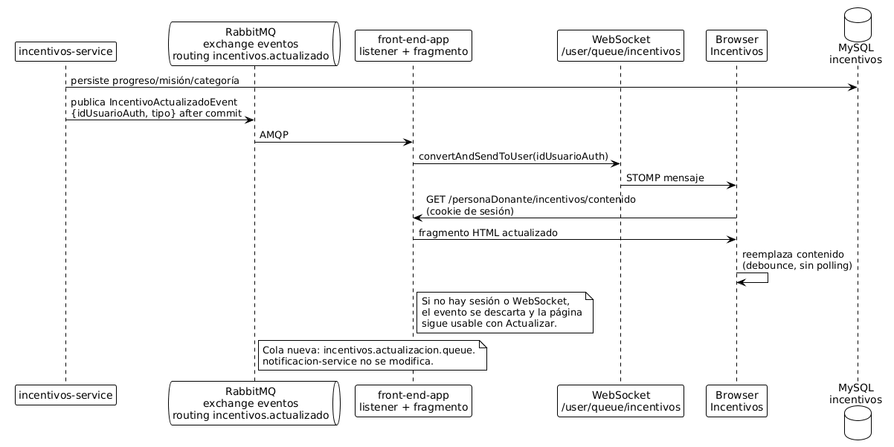

## Context

Ver `proposal.md` para la motivación y `specs/actualizacion-incentivos-tiempo-real/spec.md` para el contrato.

Estado actual relevante:

- La vista de Incentivos ya usa `GET /incentivos/{id}/estadoGeneral` para categoría, misión actual, progreso y misiones completadas; `IncentivosMapper` mapea esos datos reales.
- `incentivos-service` ya genera paquetes `MISION_COMPLETADA` y `CATEGORIA_COMPLETADA` para notificaciones, pero `NotificationDto` no tiene un `idUsuarioAuth` estable y `PaqueteNotificacionFactory` no crea el paquete si el donante no tiene contactos.
- `front-end-app` no consume RabbitMQ hoy; tiene `spring-boot-starter-amqp` pero no configuración de broker.
- `WebSocketConfig` usa un broker simple con `/topic` para el mapa (`/topic/posicion-camion`); no tiene destinations por usuario ni un endpoint autenticado para incentivos.
- La sesión del frontend guarda `idUsuarioAuth` al iniciar sesión; el mapa ya carga SockJS/STOMP desde CDN.
- `EnvioDePaquetesSchedule` envía paquetes cada 60 segundos; no sirve para una actualización inmediata.

### Diagrama: evento y actualización

[](diagrams/incentivos-tiempo-real.png)

## Goals / Non-Goals

**Goals:**
- Publicar un evento dedicado cuando cambia el progreso, la misión, la insignia o la categoría.
- Entregarlo solo a la sesión del donante destinatario.
- Actualizar la vista de Incentivos sin recargar y sin polling.
- Mantener la vista usable si el WebSocket o RabbitMQ fallan.

**Non-Goals:**
- Mi impacto (no usa este canal).
- Publicación social/N8N, ranking y seed de categorías.
- Cambios en `notificacion-service` o en la cola de notificaciones.
- Reemplazar el envío de email/SMS/WhatsApp existente.
- Estado completo de la vista dentro del evento.

## Decisions

### D1: Evento dedicado, no `NotificationDto`

Se crea `IncentivoActualizadoEvent` con `idUsuarioAuth`, `idDonanteDonacionesService`, `motivo` y `fecha`. No se reutiliza `NotificationDto` porque no tiene un identificador estable de destinatario y se descarta si el donante no tiene contactos. El evento de UI debe publicarse siempre que exista una sesión de donante.

**Pseudocódigo:**

```text
record IncentivoActualizadoEvent(
  Long idUsuarioAuth,
  Long idDonanteDonacionesService,
  String motivo,
  LocalDateTime fecha
)

IncentivoActualizadoPublisher.publicar(Donante donante, String motivo):
  if donante.getIdUsuarioAuth() == null:
    return
  event = new IncentivoActualizadoEvent(
      donante.getIdUsuarioAuth(),
      donante.getIdDonanteDonacionesService(),
      motivo,
      LocalDateTime.now())
  rabbitTemplate.convertAndSend("eventos", "incentivos.actualizado", event)
```

### D2: Publicar después del commit

El evento se emite cuando la transacción que cambió el estado ya se confirmó. Si la operación falla y se revierte, no se publica nada.

**Pseudocódigo:**

```text
DonacionServiceImpl.agregarDonacion(...):
  ...
  donanteService.guardarDonante(donante)
  transactionSynchronization.afterCommit(() ->
      incentivoActualizadoPublisher.publicar(donante, "DONACION_REGISTRADA"))

DonacionServiceImpl.marcarDonacionComoRecibida(...):
  ...
  donanteService.guardarDonante(donante)
  transactionSynchronization.afterCommit(() ->
      incentivoActualizadoPublisher.publicar(donante, "DONACION_RECIBIDA"))

IncentivoServiceImpl.reiniciarMisionesMensuales():
  ...
  donanteService.guardarDonante(donante)
  transactionSynchronization.afterCommit(() ->
      incentivoActualizadoPublisher.publicar(donante, "MISION_REINICIADA"))
```

Se puede implementar con `TransactionSynchronizationManager.registerSynchronization(...)` o con un evento de dominio escuchado con `@TransactionalEventListener(phase = AFTER_COMMIT)`.

### D3: Topología RabbitMQ separada de notificaciones

Se usa el exchange existente `eventos` con una routing key nueva `incentivos.actualizado`. `front-end-app` declara una cola propia `incentivos.actualizacion.queue` y su binding. La cola de `notificacion-service` no se toca.

**Pseudocódigo:**

```text
@RabbitListener(bindings = @QueueBinding(
    value = @Queue(name = "incentivos.actualizacion.queue", durable = "true"),
    exchange = @Exchange(name = "eventos", type = ExchangeTypes.DIRECT),
    key = "incentivos.actualizado"))
void onIncentivoActualizado(IncentivoActualizadoEvent event):
  if event.idUsuarioAuth() == null:
    return
  messagingTemplate.convertAndSendToUser(
      String.valueOf(event.idUsuarioAuth()),
      "/queue/incentivos",
      event)
```

### D4: WebSocket con destinations por usuario

Se agrega `/ws-incentivos`, se habilita `/queue` en el broker simple y se configura `/user` como prefijo de destinations. El handshake toma `idUsuarioAuth` de la sesión HTTP y lo usa como nombre del `Principal`; así `convertAndSendToUser` entrega solo a esa sesión. `/ws-rutas` y `/topic/posicion-camion` quedan igual.

**Pseudocódigo:**

```text
WebSocketConfig.configureMessageBroker(config):
  config.enableSimpleBroker("/topic", "/queue")
  config.setApplicationDestinationPrefixes("/app")
  config.setUserDestinationPrefix("/user")

WebSocketConfig.registerStompEndpoints(registry):
  registry.addEndpoint("/ws-rutas").setAllowedOriginPatterns("*").withSockJS()
  registry.addEndpoint("/ws-rutas").setAllowedOriginPatterns("*")
  registry.addEndpoint("/ws-incentivos")
      .setAllowedOriginPatterns("*")
      .setHandshakeHandler(new IdUsuarioAuthHandshakeHandler())
      .withSockJS()

IdUsuarioAuthHandshakeHandler.determineUser(request, wsHandler, attributes):
  session = request.getServletRequest().getSession(false)
  id = session != null ? session.getAttribute("idUsuarioAuth") : null
  if id == null: return null // rechaza el handshake
  return () -> id.toString()
```

### D5: El evento es una señal; la página refresca su fragmento

El evento no transporta categoría, misión ni progreso: solo indica “actualizá”. El navegador pide el fragmento SSR de Incentivos a un endpoint same-origin, que resuelve el donante desde la sesión y reutiliza `IncentivosApiService.obtenerIncentivos`. Así no se duplica el mapeo de la vista ni se expone estado sensible en el evento.

**Pseudocódigo:**

```text
GET /personaDonante/incentivos/contenido:
  @PreAuthorize("hasAuthority('VER_MIS_INCENTIVOS')")
  donanteId = resolverDonanteId(session)
  incentivos = incentivosApiService.obtenerIncentivos(donanteId)
  model.addAttribute("incentivos", incentivos)
  return "personaDonante/incentivos :: contenidoIncentivos"

incentivos.js al recibir mensaje:
  programarRefresco() // debounce 300 ms
  refrescarContenido():
    html = fetch("/personaDonante/incentivos/contenido", {credentials: "same-origin"})
    contenedor.innerHTML = html
    inicializarFiltrosMisiones()
```

### D6: Sin polling, con reconexión y fallback manual

No hay `setInterval` ni consultas periódicas. Si el WebSocket se cierra, se reintenta con backoff; la página conserva el contenido y muestra “actualización en vivo desconectada”. El botón “Actualizar” ejecuta `refrescarContenido()`.

**Pseudocódigo:**

```text
conectar():
  stomp = Stomp.over(new SockJS("/ws-incentivos"))
  stomp.connect({}, ok, error)
  stomp.subscribe("/user/queue/incentivos", programarRefresco)
  onclose -> mostrarDesconectado(); reintentarConBackoff()

botonActualizar.onclick = refrescarContenido
```

### D7: Configuración RabbitMQ del frontend

`front-end-app` agrega la configuración del broker y las variables en Docker Compose. No se agrega una dependencia nueva: `spring-boot-starter-amqp` ya está.

**Pseudocódigo:**

```text
spring:
  rabbitmq:
    host: ${SPRING_RABBITMQ_HOST:localhost}
    port: ${SPRING_RABBITMQ_PORT:5672}
    username: ${SPRING_RABBITMQ_USER:guest}
    password: ${SPRING_RABBITMQ_PASSWORD:guest}
```

En `docker-compose.yml`, servicio `front-end-app`:
`SPRING_RABBITMQ_HOST=rabbitmq`, `SPRING_RABBITMQ_PORT=5672`, usuario/clave `guest`/`guest`.

### D8: Seguridad y alcance del evento

El evento solo lleva identificadores y motivo; no incluye contactos ni datos sensibles. La autorización real ocurre en el handshake (sesión) y en el endpoint del fragmento (permiso + donante de la sesión). Una sesión no puede suscribirse a la cola de otro usuario porque la destination `/user/queue/incentivos` se resuelve contra su propio `Principal`.

**Pseudocódigo:**

```text
si session.idUsuarioAuth == null:
  rechazar handshake
si evento.idUsuarioAuth != principal.idUsuarioAuth:
  no entregar (la destination ya lo garantiza)
```

## Risks / Trade-offs

- [Riesgo] El handshake WebSocket no herede la sesión y quede sin principal → Mitigación: handshake handler que lee `idUsuarioAuth` de `HttpSession` y rechaza si falta; test de conexión autenticada y anónima.
- [Riesgo] El frontend-app no tenga RabbitMQ configurado en Docker → Mitigación: D7 + verificación de conexión al broker en el arranque.
- [Riesgo] Publicar antes del commit y avisar de un cambio revertido → Mitigación: D2 (after commit).
- [Riesgo] Eventos duplicados o rápidos generen múltiples fetches → Mitigación: debounce de 300 ms y refresco idempotente del fragmento.
- [Riesgo] Si RabbitMQ está caído, el evento se pierde y la página no se actualiza → Mitigación: la vista sigue usable; botón Actualizar y aviso de desconexión. No se promete entrega garantizada.
- [Riesgo] El `front-end-app` se reinicia y la cola retiene eventos → Mitigación: la cola es durable; al volver a conectar se procesan y el fetch es idempotente.
- [Trade-off] Señal + fetch vs evento con estado completo → se elige señal + fetch para no duplicar el mapeo de la vista y mantener el evento pequeño; cuesta un request HTTP extra por evento.
- [Riesgo] La sesión expira mientras la página está abierta → Mitigación: el handshake/reconexión falla, se muestra desconectado y el botón Actualizar redirige al login si la sesión ya no es válida.

## Migration Plan

1. Agregar `IncentivoActualizadoEvent`, publisher y llamadas after-commit en `incentivos-service`; tests.
2. Agregar configuración RabbitMQ y listener en `front-end-app`; verificar consumo de la cola.
3. Agregar `/ws-incentivos`, user destinations y handshake; probar conexión autenticada y anónima.
4. Extraer el fragmento de Incentivos y agregar el endpoint `/personaDonante/incentivos/contenido`.
5. Agregar `incentivos.js` (STOMP, refresh, reconexión) y el aviso de desconexión.
6. Agregar variables RabbitMQ al `docker-compose.yml` y probar el flujo E2E con admin + donante.
7. Rollback: revertir el change; la vista de Incentivos sigue funcionando con el SSR actual y sin actualización en vivo.

## Historial de versiones de este design

| Fecha | Autor | Cambio |
|---|---|---|
| 2026-11-06 | opencode | Diseño inicial: evento dedicado, RabbitMQ, WebSocket por usuario y refresh del fragmento de Incentivos. |
