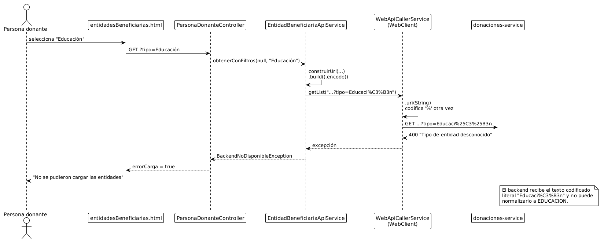
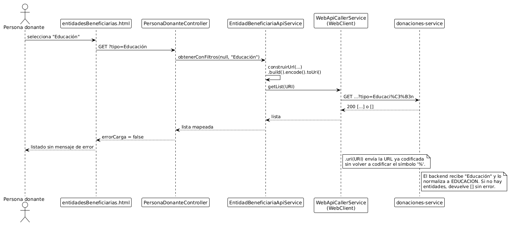

## Context

Ver `proposal.md` para la motivación y `specs/filtros-entidades-beneficiarias/spec.md` para el contrato de comportamiento.

Estado actual relevante:

- `EntidadBeneficiariaApiService.construirUrl(...)` arma la URL con `UriComponentsBuilder` y llama a `.build().encode()`, por lo que `tipo=Educación` sale como `tipo=Educaci%C3%B3n`.
- `WebApiCallerService` recibe esa URL como `String` y ejecuta `webClient.get().uri(url)`. El `DefaultUriBuilderFactory` del `WebClient` vuelve a codificar el `%`, y el backend recibe `tipo=Educaci%25C3%25B3n`.
- `donaciones-service` normaliza el tipo y, al no reconocer el valor literal, responde `400 Bad Request`; el frontend lo traduce a `BackendNoDisponibleException` y muestra el mensaje genérico.
- El mismo mecanismo afecta `busqueda` cuando el texto tiene acentos: no produce 400, pero busca la cadena codificada literal y devuelve resultados vacíos.

### Diagrama: comportamiento actual

[](diagrams/encoding-filtros-actual.png)

### Diagrama: comportamiento propuesto

[](diagrams/encoding-filtros-propuesto.png)

## Goals / Non-Goals

**Goals:**
- Enviar los query params codificados exactamente una vez.
- Mantener el encoding de caracteres especiales (`&`, `=`, espacios) que ya resuelve `UriComponentsBuilder`.
- Cubrir con tests el tipo `Educación`, la búsqueda con acentos y la combinación de ambos.

**Non-Goals:**
- Agregar estado vacío cuando el filtro no devuelve entidades.
- Sembrar entidades de tipo `EDUCACION` o cambiar datos.
- Modificar el backend, los templates o el contrato HTTP.

## Decisions

### D1: Enviar una `URI` ya codificada en lugar de un `String`

`construirUrl` pasa a devolver `java.net.URI` y `WebApiCallerService` incorpora overloads `getList(URI, ...)` y `get(URI, ...)` que usan `webClient.get().uri(uri)`. La variante que recibe `URI` no vuelve a codificar el `%`, así que el backend recibe el valor original.

**Pseudocódigo:**

```text
static URI construirUrl(String base, String busqueda, String tipo):
  builder = UriComponentsBuilder.fromUriString(base + "/entidades-beneficiarias")
  if busqueda no blank:
    builder.queryParam("busqueda", busqueda)
  if tipo no blank:
    builder.queryParam("tipo", tipo)
  return builder.build().encode().toUri()

WebApiCallerService.getList(URI url, Class<T> responseType):
  return executeWithTokenRetry(accessToken ->
    webClient.get()
      .uri(url)
      .header("Authorization", "Bearer " + accessToken)
      .retrieve()
      .bodyToFlux(responseType)
      .collectList()
      .block()
  )

EntidadBeneficiariaApiService.obtenerConFiltros(busqueda, tipo):
  uri = construirUrl(donacionesServiceUrl, busqueda, tipo)
  response = webApiCallerService.getList(uri, EntidadBeneficiariaResponse.class)
  return EntidadVistaMapper.aVista(response)
```

**Consecuencia en tests:** `EntidadBeneficiariaApiServiceUrlTest` compara contra `URI` (o contra `uri.toString()`) y agrega casos con `tipo=Educación` y `busqueda=Colón`, incluyendo la combinación de ambos.

## Risks / Trade-offs

### Alternativas consideradas

- **A. `URI` pre-codificada + overloads en `WebApiCallerService`** (elegida): mantiene el encoding actual y evita la segunda codificación; el cambio queda acotado al servicio de entidades y al caller HTTP.
- **B. `EncodingMode.NONE` global en el `WebClient`**: una línea de configuración, pero afecta todas las llamadas; las URLs que hoy dependen de la codificación automática podrían romperse.
- **C. Quitar `.encode()` de `construirUrl`**: deja que el `WebClient` codifique una vez, pero pierde el escape de `&`/`=` dentro de `busqueda` y obliga a cambiar el test de URL.
- **D. Armar la query con el `UriBuilder` del `WebClient`**: es la solución más limpia a largo plazo, pero requiere un refactor más amplio del `WebApiCallerService`.

### Comparativa

| Criterio | A. URI | B. EncodingMode.NONE | C. Sin `.encode()` | D. UriBuilder |
|---|---|---|---|---|
| Corrige el doble encoding | Sí | Sí | Sí | Sí |
| Alcance del cambio | Bajo | Bajo | Bajo | Medio |
| Riesgo sobre otras llamadas | Bajo | Alto | Medio | Bajo |
| Conserva escape de `&`/`=` | Sí | Sí | No | Sí |
| Esfuerzo | Bajo | Muy bajo | Bajo | Medio |

### Decisión recomendada

**A**, porque corrige la causa sin alterar el comportamiento global del cliente HTTP ni perder el escape de caracteres especiales. El costo es agregar un overload y ajustar el test de URL.

### Riesgos

- [Riesgo] El overload `getList(URI, ...)` se use con una URL no codificada y falle → Mitigación: solo lo consume `EntidadBeneficiariaApiService`, que siempre pasa por `construirUrl`; los demás servicios siguen usando la firma `String`.
- [Riesgo] El test de URL quede atado a una representación específica → Mitigación: comparar el `URI` resultante y cubrir explícitamente acentos y combinación de filtros.
- [Trade-off] Después del fix, el filtro Educación puede devolver `[]` porque el seed no tiene entidades de ese tipo; la vista mostrará una grilla vacía, no un error. Queda fuera del alcance por decisión del usuario.

## Migration Plan

1. Agregar los overloads `URI` en `WebApiCallerService` y compilar `front-end-app`.
2. Cambiar `construirUrl` y su uso en `EntidadBeneficiariaApiService`; actualizar el test de URL.
3. Ejecutar `mvn -pl front-end-app -am test` y verificar el caso `tipo=Educación` contra el backend.
4. Rollback: revertir el change; no hay migración de datos ni cambios de contrato.

## Historial de versiones de este design

| Fecha | Autor | Cambio |
|---|---|---|
| 2026-10-28 | opencode | Diseño inicial: diagnóstico del doble encoding, diagramas actual/propuesto y decisión de enviar `URI` pre-codificada. |
