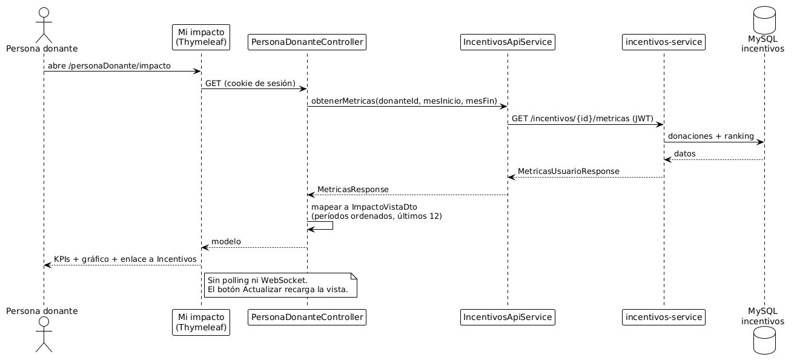

## Context

Ver `proposal.md` para la motivación y `specs/impacto-donante/spec.md` para el contrato.

Estado actual:

- `incentivos-service` expone `GET /incentivos/{id}/metricas` con `totalHistoricoDonaciones`, `posicionRanking`, `donacionesPorPeriodo`, `comparacionDeMeses` y `organizacionesQueAyudo`.
- `donacionesPorPeriodo` es un `TreeMap` con claves `YYYY-MM` y valores `Number`; el backend completa los meses sin donaciones con cero.
- `posicionRanking` se lee del último ranking persistido y puede ser `0` si no hay ranking.
- El endpoint `/metricas` no tiene `@PreAuthorize` ni valida que el `id` pertenezca al donante autenticado.
- El frontend no tiene `MetricasResponse` ni un método `obtenerMetricas`; `IncentivosApiService` solo consume misiones, insignias y estado general.
- No existe una vista de impacto; `misDonaciones` es historial y `entidadesBeneficiarias` solo muestra el contador mensual.

### Diagrama: carga de Mi impacto

[](diagrams/impacto-donante.png)

## Goals / Non-Goals

**Goals:**
- Una vista de solo lectura con KPIs históricos, posición en el ranking y gráfico mensual.
- Reutilizar el endpoint existente y mantener el cambio acotado al frontend y a la autorización.
- Mostrar estados vacíos/error honestos, sin datos de ejemplo.

**Non-Goals:**
- Progreso, insignias, categoría y actualización en vivo: pertenecen a Incentivos y a `actualizacion-incentivos-tiempo-real`.
- Publicación social, ranking y seed de categorías.
- Nuevas tablas, endpoints de `incentivos-service` o cambios de esquema.
- Polling, WebSocket o SSE en esta vista.

## Decisions

### D1: Reutilizar `/metricas` y no crear un endpoint nuevo

La vista se alimenta de una única llamada a `GET /incentivos/{id}/metricas`. El frontend agrega el DTO espejo y el método de servicio; no se crea un endpoint agregado en `incentivos-service`.

**Pseudocódigo:**

```text
record MetricasResponse(
  Number totalHistoricoDonaciones,
  Number posicionRanking,
  Map<String, Number> donacionesPorPeriodo,
  Map<String, Number> comparacionDeMeses,
  Number organizacionesQueAyudo
)

IncentivosApiService.obtenerMetricas(Long donanteId, YearMonth mesInicio, YearMonth mesFin):
  uri = incentivosServiceUrl + "/incentivos/" + donanteId + "/metricas"
  if mesInicio != null: uri += "?mesInicio=" + mesInicio
  if mesFin != null: uri += "&mesFin=" + mesFin
  return webApiCaller.get(uri, MetricasResponse.class)
```

### D2: Autorizar y validar pertenencia en `/metricas`

El endpoint pasa a exigir rol DONANTE y el permiso `VER_MIS_DONACIONES`; además valida que el `id` recibido corresponda al `idUsuarioAuth` de la sesión. Se reutiliza el patrón de `/estadoGeneral` y `/misiones`.

**Pseudocódigo:**

```text
@GetMapping("/{id}/metricas")
@PreAuthorize("hasRole('DONANTE') and hasAuthority('VER_MIS_DONACIONES')")
MetricasUsuarioResponse getMetricasDeActividad(
    @PathVariable Long id,
    @RequestParam(required = false) String fechaLimite,
    @RequestParam(required = false) String mesInicio,
    @RequestParam(required = false) String mesFin,
    Authentication authentication):
  if not donanteService.validarUsuarioDeDonante(id, getIdUsuarioAuth(authentication)):
    throw UnauthorizedException("Un donante puede ver solo sus metricas")
  return incentivoService.getMetricasUsuario(id, parse(fechaLimite), parse(mesInicio), parse(mesFin))
```

### D3: Mapear los períodos y el ranking a la vista

El backend devuelve un mapa; el frontend lo convierte a una lista ordenada y toma los últimos doce meses para el gráfico. La posición se muestra como “Último ranking” porque el DTO actual no incluye el período del ranking; si no hay ranking, se muestra “Sin ranking”.

**Pseudocódigo:**

```text
record PeriodoDonaciones(String periodo, int cantidad)

ImpactoVistaDto aVista(MetricasResponse metricas):
  periodos = metricas.donacionesPorPeriodo().entrySet()
      .stream()
      .sorted(by key)
      .map(e -> new PeriodoDonaciones(e.key(), e.value().intValue()))
      .toList()
  ultimos12 = periodos.size() <= 12 ? periodos : periodos.sublist(periodos.size() - 12, periodos.size())
  return new ImpactoVistaDto(
      metricas.totalHistoricoDonaciones(),
      metricas.organizacionesQueAyudo(),
      metricas.posicionRanking(),
      ultimos12,
      metricas.comparacionDeMeses())
```

### D4: Gráfico de barras CSS/SVG, sin librería

Se dibuja una barra por período con altura proporcional al máximo; se muestran etiquetas de mes y el valor. Es accesible con texto alternativo/tabla oculta y no agrega dependencias.

**Pseudocódigo:**

```text
renderGrafico(periodos):
  max = max(cantidad de periodos, 1)
  para cada periodo:
    altura = cantidad * 100 / max
    crear barra con data-periodo, data-cantidad, style.height = altura + "%"
    agregar etiqueta de mes y valor
  si periodos vacio:
    mostrar estado "Todavia no hay donaciones"
```

### D5: Foto con actualización manual, sin polling

La vista carga los datos una vez al ingresar. El botón “Actualizar” recarga la vista (`location.reload()`); no hay intervalo, WebSocket ni SSE. Esto mantiene el alcance de Mi impacto separado de la actualización en vivo de Incentivos.

**Pseudocódigo:**

```text
botonActualizar.addEventListener("click", () => window.location.reload())
```

### D6: No duplicar Incentivos

La vista no consume `/estadoGeneral`, no muestra misión, progreso, insignias ni categoría. Solo incluye un enlace a `/personaDonante/incentivos`.

**Pseudocódigo:**

```text
<a th:href="@{/personaDonante/incentivos}">Ver mi progreso e insignias</a>
```

## Risks / Trade-offs

- [Riesgo] La posición de ranking puede ser de un mes anterior y no del mes en curso → Mitigación: etiquetar “Último ranking” y mostrar “Sin ranking” si es 0.
- [Riesgo] `donacionesPorPeriodo` puede tener muchos meses → Mitigación: mostrar solo los últimos 12 y ordenar por clave.
- [Riesgo] El endpoint `/metricas` no está autorizado hoy → Mitigación: D2 y test de acceso con otro donante.
- [Trade-off] El botón Actualizar recarga la página en vez de refrescar parcialmente → se acepta para mantener la vista simple; la actualización en vivo es un cambio aparte.
- [Riesgo] Si `incentivos-service` no responde, la vista no debe mostrar datos ficticios → Mitigación: estado de error con reintento, sin fallback de ejemplo.

## Migration Plan

1. Agregar autorización y validación a `/metricas`; tests de backend.
2. Agregar `MetricasResponse`, `ImpactoMapper` y `IncentivosApiService.obtenerMetricas`; tests de URL/mapeo.
3. Agregar la ruta, el template, el CSS, el gráfico y el enlace de navegación.
4. Ejecutar `mvn -pl front-end-app -am test` y `mvn -pl incentivos-service -am test`.
5. Rollback: revertir el change; no hay migración de datos ni cambios de contrato fuera de `/metricas`.

## Historial de versiones de este design

| Fecha | Autor | Cambio |
|---|---|---|
| 2026-11-06 | opencode | Diseño inicial: Mi impacto como foto de métricas, reutilizando `/metricas` sin polling. |
