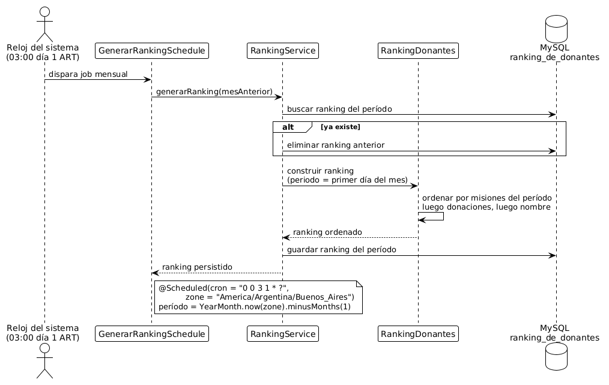
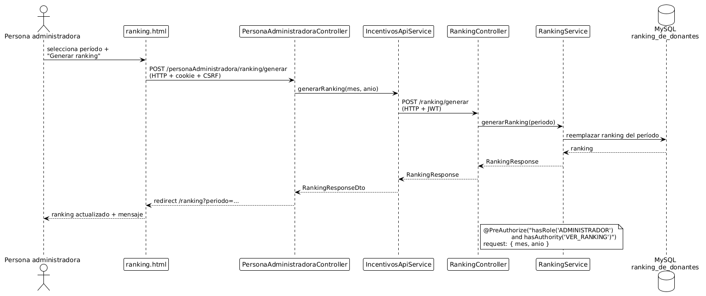

## Context

Ver `proposal.md` para la motivación y `specs/ranking-mensual-donantes/spec.md` para el contrato de comportamiento.

Estado actual relevante:

- `GenerarRankingSchedule` no tiene `@Component`, así que el `@Scheduled` no se registra; además el cron `* * * 1 * ?` correría cada segundo del día 1 si fuera bean.
- `RankingServiceImpl.generarRanking()` usa `LocalDate.now()` como fecha del ranking; el período queda asociado a la fecha de generación, no al mes calculado.
- `RankingDonantes.generarRanking(List<Donante>)` ordena primero por donaciones del período, después por misiones y después por donaciones totales.
- `RankingDonantes` se puede construir sin fecha y el `DataInitializer` arma un ranking manual sin ordenar.
- `RankingController` solo expone `GET /ranking`; no hay generación a demanda.
- La vista `ranking.html` muestra la columna "Donaciones" y no tiene acción para generar.
- `ReinicioDeMisionesSchedule` sí es bean, pero comparte el cron incorrecto `* * * 1 * ?`.

### Diagrama: generación programada

[](diagrams/ranking-programado.png)

### Diagrama: generación a demanda

[](diagrams/ranking-demanda.png)

## Goals / Non-Goals

**Goals:**
- Generar el ranking del mes cerrado una vez por mes, a las 03:00 del día 1 en zona Argentina.
- Poder recalcular cualquier período desde la vista del administrador.
- Ordenar por misiones completadas en el período y mostrar esa columna.
- Persistir un único ranking por período y evitar duplicados por regeneración.

**Non-Goals:**
- Panel de impacto del donante.
- Publicación social/N8N.
- Progreso real de misiones en la vista del donante.
- Notificaciones.

## Decisions

### D1: El período del ranking es el mes cerrado y se guarda como primer día del mes

El job programado calcula `YearMonth.now(zone).minusMonths(1)` y el ranking se persiste con `fechaRanking = periodo.atDay(1)`. Así `RankingDonantes.getPeriodo()` y las consultas por año/mes no dependen de la fecha en que corrió el job.

**Pseudocódigo:**

```text
ZoneId zona = ZoneId.of("America/Argentina/Buenos_Aires")
YearMonth periodo = YearMonth.now(zona).minusMonths(1)

RankingDonantes ranking = new RankingDonantes(periodo.atDay(1), donantes)
rankingRepository.save(ranking)
```

### D2: Scheduler bean y cron a las 03:00 del día 1

`GenerarRankingSchedule` pasa a ser `@Component` y usa `@Scheduled(cron = "0 0 3 1 * ?", zone = "America/Argentina/Buenos_Aires")`. `ReinicioDeMisionesSchedule` recibe la misma expresión y zona.

**Pseudocódigo:**

```text
@Component
class GenerarRankingSchedule:
  @Scheduled(cron = "0 0 3 1 * ?", zone = "America/Argentina/Buenos_Aires")
  void generarRankingMensual():
    YearMonth periodo = YearMonth.now(ZoneId.of("America/Argentina/Buenos_Aires")).minusMonths(1)
    rankingService.generarRanking(periodo)

@Component
class ReinicioDeMisionesSchedule:
  @Scheduled(cron = "0 0 3 1 * ?", zone = "America/Argentina/Buenos_Aires")
  void reiniciarMisionesMensuales():
    incentivoService.reiniciarMisionesMensuales()
```

### D3: Generación idempotente por período

`RankingService` incorpora `generarRanking(YearMonth periodo)`. Si ya existe un ranking para ese período, se elimina y se guarda uno nuevo dentro de la misma transacción. El resultado es un único ranking por mes, sin importar si lo disparó el scheduler o el administrador.

**Pseudocódigo:**

```text
@Transactional
RankingDonantes generarRanking(YearMonth periodo):
  existentes = rankingRepository.findByAnioAndMes(periodo.year, periodo.monthValue)
  existentes.forEach(rankingRepository::delete)

  donantes = donanteService.findAll()
  ranking = new RankingDonantes(periodo.atDay(1), donantes)
  return rankingRepository.save(ranking)

RankingDonantes generarRanking():
  return generarRanking(YearMonth.now(ZoneId.of("America/Argentina/Buenos_Aires")))

Number buscarPosicionDonanteEnRanking(Long id):
  ranking = rankingRepository.findFirstByOrderByFechaRankingDesc().orElse(null)
  return ranking != null ? ranking.obtenerPosicion(id) : 0
```

La última parte evita que `GET /incentivos/{id}/metricas` cree rankings como efecto colateral.

### D4: Orden por misiones del período e inclusión

El comparador usa `getMisionesCompletadasEnPeriodo(periodo)` como criterio principal. Solo entran donantes con al menos una misión en el período; se desempata por donaciones del período y luego por nombre.

**Pseudocódigo:**

```text
lista = donantes.stream()
  .map(d -> {
    misiones = d.getMisionesCompletadasEnPeriodo(periodo)
    donaciones = d.getDonacionesEnPeriodo(periodo)
    nombre = d.getNombreUsuario()
  })
  .filter(x -> x.misiones > 0)
  .sorted(comparing(x -> x.misiones).reversed()
          .thenComparing(x -> x.donaciones).reversed()
          .thenComparing(x -> x.nombre, nullsLast(naturalOrder())))
  .toList()

ranking = lista.indexed().map((d, i) -> new DonanteEnRanking(d, i + 1))
```

### D5: Generación a demanda desde la vista del administrador

Backend: `POST /ranking/generar` recibe `{mes, anio}`, valida el período, llama a `generarRanking(periodo)` y devuelve el `RankingResponse`. Reutiliza el permiso `VER_RANKING` del administrador.

Frontend: `IncentivosApiService.generarRanking(mes, anio)` hace el POST; `PersonaAdministradoraController` expone `POST /ranking/generar` con el período seleccionado, agrega flash `exito`/`error` y redirige a la vista del período.

**Pseudocódigo:**

```text
record GenerarRankingRequest(Integer mes, Integer anio):
  validar mes entre 1 y 12
  validar anio >= 2000

@PostMapping("/generar")
@PreAuthorize("hasRole('ADMINISTRADOR') and hasAuthority('VER_RANKING')")
RankingResponse generar(@RequestBody GenerarRankingRequest request):
  periodo = YearMonth.of(request.anio(), request.mes())
  return RankingResponse.from(rankingService.generarRanking(periodo))

@PostMapping("/ranking/generar")
@PreAuthorize("hasAuthority('VER_RANKING')")
String generarRanking(@RequestParam String periodo, RedirectAttributes redirect):
  (anio, mes) = parsear(periodo)
  try:
    incentivosApiService.generarRanking(mes, anio)
    redirect.addFlashAttribute("exito", "Ranking generado para " + periodo)
  catch:
    redirect.addFlashAttribute("error", "No se pudo generar el ranking")
  return "redirect:/personaAdministradora/ranking?periodo=" + periodo
```

### D6: La tabla muestra misiones y la acción de generar

`ranking.html` agrega la columna "Misiones" (principal) y conserva "Donaciones" como dato secundario. El subtítulo y el caption indican que el orden es por misiones del período. Se agrega un formulario POST para generar el período seleccionado y un bloque de alertas con las clases `alertaFormulario alertaExito/alertaError` ya usadas en otras vistas del administrador.

**Pseudocódigo:**

```text
<form method="post" th:action="@{/personaAdministradora/ranking/generar}">
  <input type="hidden" name="periodo" id="periodoGenerar" th:value="${periodoSeleccionado}">
  <button type="submit">Generar ranking</button>
</form>

<table>
  <th>Posición</th>
  <th>Donante</th>
  <th>Misiones</th>
  <th>Donaciones</th>
  <td th:text="${donante.misionesCompletadas}">0</td>
  <td th:text="${donante.cantidadDonaciones}">0</td>
</table>

<div th:if="${exito}" class="alertaFormulario alertaExito" th:text="${exito}"></div>
<div th:if="${error}" class="alertaFormulario alertaError" th:text="${error}"></div>
```

### D7: Seed y backfill

El `DataInitializer` deja de armar el ranking a mano. Si no hay rankings, crea uno real para el mes anterior usando el mismo constructor que ordena por misiones. El ranking de octubre 2026 existente se regenera una vez con el endpoint a demanda después del deploy.

**Pseudocódigo:**

```text
if rankingRepository.count() == 0:
  periodo = YearMonth.now(ZoneId.of("America/Argentina/Buenos_Aires")).minusMonths(1)
  ranking = new RankingDonantes(periodo.atDay(1), donanteRepository.findAll())
  rankingRepository.save(ranking)
```

Backfill manual después del deploy:

```text
POST /ranking/generar { "mes": 10, "anio": 2026 }
```

### D8: Corregir el cron del reinicio de misiones

`ReinicioDeMisionesSchedule` mantiene su lógica, pero pasa de ejecutarse cada segundo del día 1 a una vez a las 03:00 ART. No borra misiones completadas; solo reinicia el progreso de misiones de racha, por lo que no compite con el cálculo del ranking.

**Pseudocódigo:**

```text
@Scheduled(cron = "0 0 3 1 * ?", zone = "America/Argentina/Buenos_Aires")
void reiniciarMisionesMensuales():
  incentivoService.reiniciarMisionesMensuales()
```

## Risks / Trade-offs

### Alternativas consideradas

- **A. Ranking del mes anterior a las 03:00 (elegida):** el mes está cerrado y no hay tráfico de medianoche.
- **B. Ranking del mes en curso a las 03:00:** muestra datos parciales y no representa un cierre mensual.
- **C. Un ranking nuevo por cada ejecución:** conserva snapshots, pero complica la consulta por período y puede duplicar el ranking del mes.
- **D. Generar en el GET del administrador:** simple, pero un GET no debería mutar datos y generaría rankings con cada visita.

### Comparativa

| Criterio | A | B | C | D |
|---|---|---|---|---|
| Mes completo | Sí | No | Depende | Depende |
| Consulta consistente por período | Sí | Sí | No (duplicados) | Sí |
| Mutación explícita | Sí | Sí | Sí | No |
| Riesgo de duplicados | Bajo | Bajo | Alto | Medio |

### Decisión recomendada

**A + persistencia única por período + POST explícito.** Es la combinación que cumple el cierre mensual, evita duplicados y mantiene el GET del ranking como lectura.

### Riesgos

- [Riesgo] Rankings existentes con `fechaRanking` en la fecha de generación → Mitigación: regenerar el período con el endpoint; la consulta por año/mes los encuentra y los reemplaza.
- [Riesgo] Scheduler y admin generan el mismo período a la vez → Mitigación: `generarRanking(periodo)` elimina y recrea dentro de una transacción; si se quiere blindar, agregar índice único sobre `fecha_ranking` en un cambio posterior.
- [Riesgo] El seed no tiene misiones en el mes anterior y el ranking queda vacío → Mitigación: la vista muestra estado vacío y el admin puede generar el período; para la demo se puede ajustar el seed de misiones.
- [Trade-off] Se reutiliza `VER_RANKING` para el POST en vez de crear `GENERAR_RANKING`; evita tocar autenticación, pero mezcla lectura y mutación bajo el mismo permiso. Queda como mejora futura.
- [Trade-off] `buscarPosicionDonanteEnRanking` deja de generar rankings; si no hay ranking persistido, devuelve 0 en vez de calcular uno al vuelo.

## Migration Plan

1. Implementar el cambio de scheduler, servicio, orden, endpoint y UI; compilar `incentivos-service` y `front-end-app`.
2. Ejecutar tests de ranking y tests de frontend.
3. Desplegar y regenerar el último mes (por ejemplo octubre 2026) con `POST /ranking/generar`.
4. Verificar que el ranking de noviembre se genere a las 03:00 del día 1 o al presionar "Generar ranking".
5. Rollback: revertir el change; no hay migración de esquema. Los rankings regenerados quedan persistidos.

## Historial de versiones de este design

| Fecha | Autor | Cambio |
|---|---|---|
| 2026-11-04 | opencode | Diseño inicial: generación programada a las 03:00 ART, período anterior, orden por misiones, endpoint a demanda, UI y backfill. |
